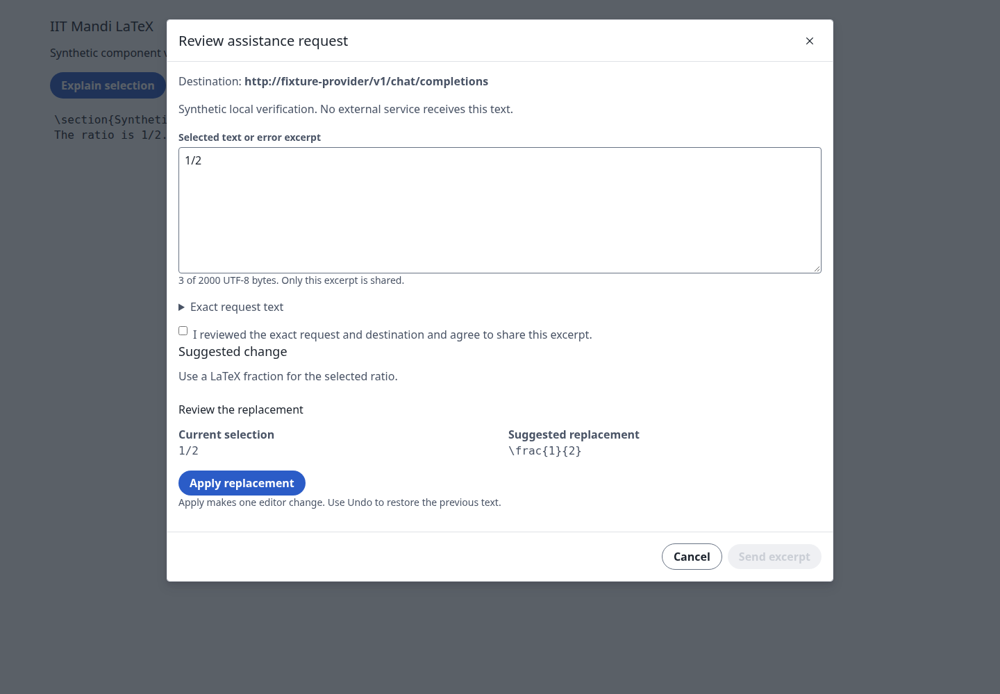
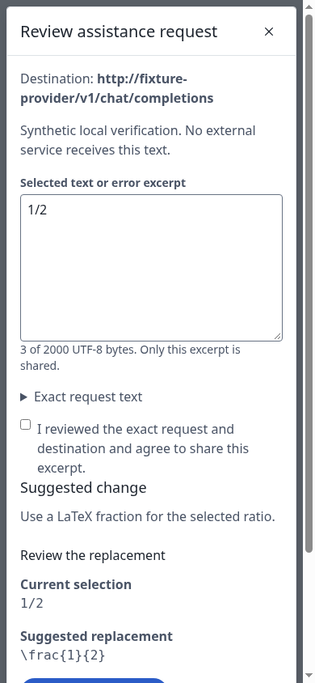

# Assistance implementation verification (#47)

16 November 2026; Institute amd64 source configuration. Managed inference stays
off unless explicitly configured. Tests below use synthetic excerpts and a fake
provider; no real project content or credentials were uploaded.

| Check | Result |
| --- | --- |
| Backend service and authorization | Passed: disabled/expired settings, policy changes, secret/size checks, malformed/failed providers, direct anonymous/reader/unrelated/share-link requests |
| Real isolated Redis | Passed: 30 simultaneous reservation attempts cannot cross the global budget; per-user/global concurrency, rate, UTC rollover, retained reservations, initialization and ledger-loss handling |
| Frontend component tests | 18 passed: request review/Cancel, old consent ignored, consent resets on edit, exact excerpt, UTF-8 bounds, redaction, escaped output, replacement/Undo/Redo and intervening collaborative edits |
| Headless Chrome desktop (1440 × 1000) | Passed: zero provider requests before consent/after Cancel; actual managed service and Redis return a synthetic suggestion; Apply/Undo/Redo work |
| Headless Chrome phone (390 × 844) | Passed: review and suggestion available; no horizontal page overflow or page errors |
| Source/format/design checks | JavaScript syntax and whitespace checks passed; mechanical UI detector returned no findings |
| Type checking | No diagnostics in the changed assistance module. The wider imported application graph reports existing missing optional modules/types, including sharing-permissions, group-settings and Writefull; a clean whole-application type check is not claimed. |

The browser harness uses the actual assistance components and the project's
compiled Sass stylesheet; authentication context and provider output are
synthetic. It does not establish production login, compilation, model quality,
latency or multi-user capacity. Required server-image CI remains the integration
gate before merge.

Backend and frontend tests are committed under
`services/web/modules/ask-ai/test/`. The optional Redis tests require
`AI_TEST_REDIS_SOCKET` pointing to a dedicated `/tmp/latex-redis/` Unix socket.
They never connect to a deployment's Redis instance. Run with one worker on
resource-constrained machines.
