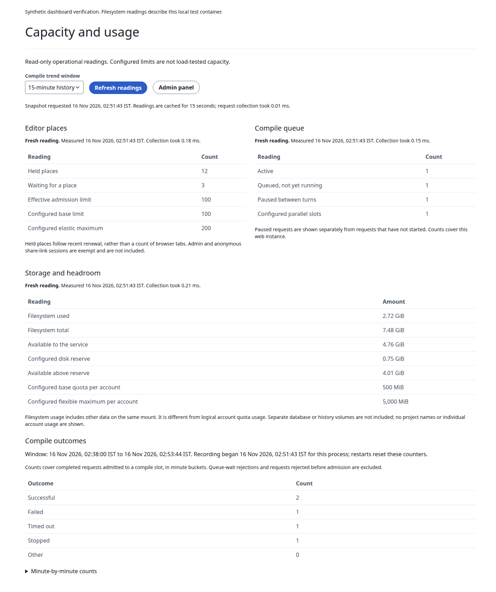
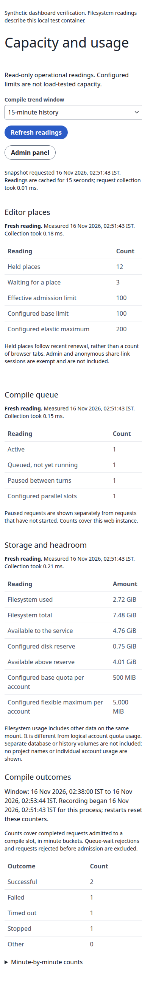
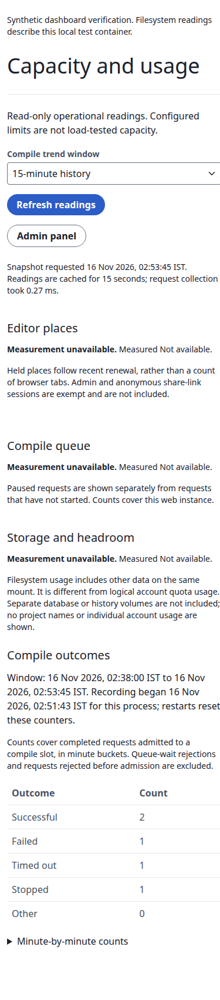

# Admin capacity and usage (#52)

The Admin Panel links to `/admin/capacity`; `/admin/capacity/data` serves the same
aggregate snapshot as JSON. Both handlers require a logged-in account and check
the current site-admin role on the server before collecting data. Responses use
`Cache-Control: private, no-store`. Neither endpoint accepts mutations.

## Inventory and source reuse

| Existing source                                                    | Reused measurement                                                                                                                                | Boundary or missing measurement                                                                                                                                                                                                         |
| ------------------------------------------------------------------ | ------------------------------------------------------------------------------------------------------------------------------------------------- | --------------------------------------------------------------------------------------------------------------------------------------------------------------------------------------------------------------------------------------- |
| `modules/admin-tools`, `/admin`                                    | Existing admin navigation, layout, login and site-admin authorization predicate                                                                   | The existing active-project view includes names/accounts; this dashboard does not reuse that identifying payload.                                                                                                                       |
| `modules/editor-waiting-room`, `/admin/editor-places`              | `EditorPlaces.stats()`: renewed holders, recent waiting heartbeats and effective/base/elastic limits                                              | Counts quota-controlled places, not all browser connections. Admin and anonymous link sessions are exempt. Expired holders and abandoned waiters are excluded without mutating Redis queue keys.                                        |
| `app/src/Features/Compile/CompileQueue.mjs`                        | A scalar-only `getSummary()`: active, not-yet-started, paused and configured slots                                                                | Community Edition's single web-process queue. Disabled limits yield unmeasured occupancy, not an invented zero. No queue entries or identities are returned.                                                                            |
| `app/src/Features/Compile/CompileManager.mjs`, `libraries/metrics` | Fixed-label `capacity-compile-outcome` counter and bounded minute histories for success/failure/timeout/stopped/other                             | Only requests that passed admission are counted. Queue-wait rejection remains in the existing `compile-queue-rejected` metric. History covers this process and resets on restart.                                                       |
| `modules/storage-quota`, `Settings.storageQuota`                   | Same storage path, default/flexible quotas and disk reserve used by quota enforcement; `statfs` gives physical used/available/above-reserve bytes | Physical filesystem usage is not logical per-owner project usage. Separate database/history mounts are not included. Existing `/user/storage` and `/user/storage/projects` are per-user support/account views, not aggregate telemetry. |
| Existing per-service `/metrics`                                    | New outcome counter uses the existing metrics library                                                                                             | No monitoring ports, Prometheus proxy, Docker controls or external analytics are exposed. Long-term cross-process history still belongs to the monitoring work in #23.                                                                  |

Paths above are relative to `services/web`, except `libraries/metrics`.
Aggregate logical project-quota totals would require a separate bounded,
scheduled collection strategy: calling every account's existing expensive usage
calculator from an admin page is intentionally avoided. No directory walks or
document-content scans occur here.

## Freshness, windows and overhead

Source reads are coalesced and cached for 15 seconds. Each source reports its
measurement timestamp and duration. A failed refresh retains the last successful
reading with an explicit **stale** state; an initial failure or malformed value
is **unavailable**, never a healthy zero. A 1.5-second deadline bounds source
collection waits, and a hanging source cannot spawn duplicate background reads.

Choose 5-, 15- or 60-minute histories and refresh explicitly. The exact time
bounds are displayed: minute alignment includes the current partial minute, so
the range can extend by up to 59 seconds. The current process's recording start
is displayed separately; zero outcomes do not imply coverage before startup.
No polling timer or background filesystem traversal is added.

The passive compile recorder keeps at most 61 minute buckets with five fixed
counters. It accepts only normalized outcome categories, not arbitrary status
messages, user IDs, project IDs, filenames, credentials or research text.

## Verification on 16 November 2026

- **80 targeted tests passed**, including existing compile-manager/queue and
  editor-limit regressions, server-side HTML/JSON authorization, source caching,
  failure/stale states, coalescing/timeouts, storage arithmetic and window input.
- The real isolated Redis source test seeded live/expired holders and
  live/abandoned waiting heartbeats. Counts reconciled to one holder and one
  waiter, and all queue keys/scores remained unchanged after reading.
- A synthetic compile workload reconciled success, failure, timeout, stopped and
  other totals and separated active/queued/paused counts without identities.
- Headless Chrome checked the actual Pug content and project stylesheet at
  1440 × 1100 and 390 × 844: window changes, refresh and minute breakdown worked;
  unavailable/stale states were explicit, with no page errors or horizontal page
  overflow. Direct controller HTTP fixtures denied anonymous/normal accounts
  before returning any readings; no marker/filename leaked into admin JSON.
- A local warm-cache run collected 1,000 synthetic snapshots in **18.69 ms**
  (**0.0187 ms mean**). Fresh source timings in that run were approximately
  0.08 ms for fixture editors, 0.04 ms for the real in-process queue and 0.16 ms
  for local filesystem metadata. These are local verification measurements, not
  Institute hardware benchmarks, model latency or a multi-user load test.

The browser harness uses synthetic authentication context, editor counts and
compile workload; filesystem metadata comes from the local test container.
It does not claim a live Institute deployment check. The normal required amd64
image/startup/template/sandbox CI remains the integration gate before merge.

