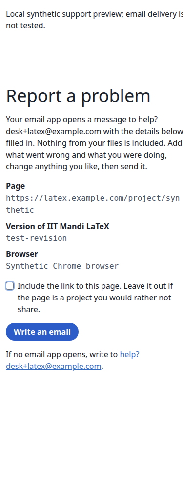
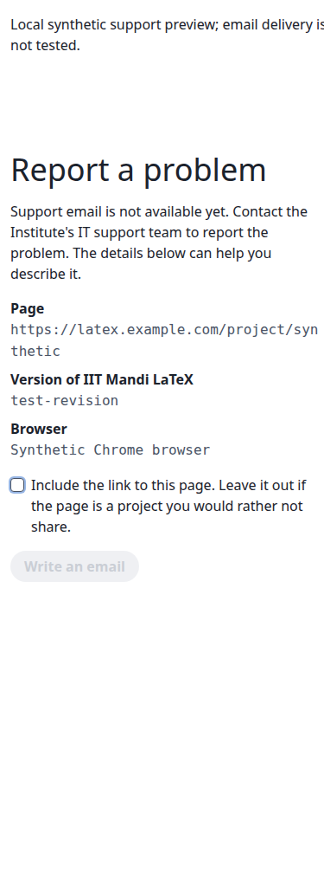

# Report a problem: review follow-up

The support preview and composer now use the existing email parser. An absent,
invalid or default `placeholder@example.com` address leaves the preview available
with a clear recovery message and disables the composer. Direct requests to the
email endpoint return the preview with HTTP 503 instead of an invalid `mailto:`
redirect. URI delimiters in an otherwise valid mailbox are percent-encoded, and
responses containing project paths or browser details use `Cache-Control:
no-store`.

Verification on 16 November 2026:

- Controller suite: **18 passed**, including the existing same-origin Referer
  checks, optional project link, unavailable addresses, attempted extra recipients
  or headers, and URI delimiters in a valid mailbox.
- Existing editor modal suite: **3 passed**.
- Headless Chrome, 1440 px and 390 px: four actual-template fixtures passed.
  Checked valid/unavailable recipient, disabled composer, absence of a fallback
  mailto when unavailable, encoded fallback recipient, optional project link and
  horizontal overflow. These are synthetic locals with the existing stylesheet,
  not a running production platform.
- Focused UI detector and `git diff --check`: clean.

The current router exposes only `/report-problem` and `/report-problem/email`;
there is no `/report-problem/address` endpoint. The preview's address is the same
public support address already exposed in settings and site contact links. No
user email lookup was added.

Pending acceptance remains explicit: confirm a monitored deployed address,
check real mail handlers/phones, and send a disposable report with permission to
verify receipt and redaction. No email was sent during these checks. The Institute
server was reachable, but `/learn` redirected to login, so deployed flags were not
verified from an authenticated session. This work does not close #10 by itself.
