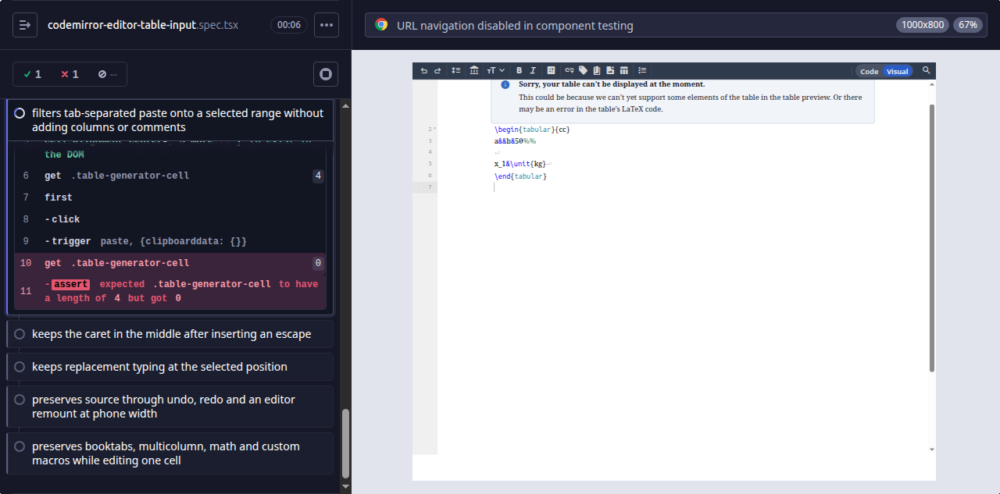
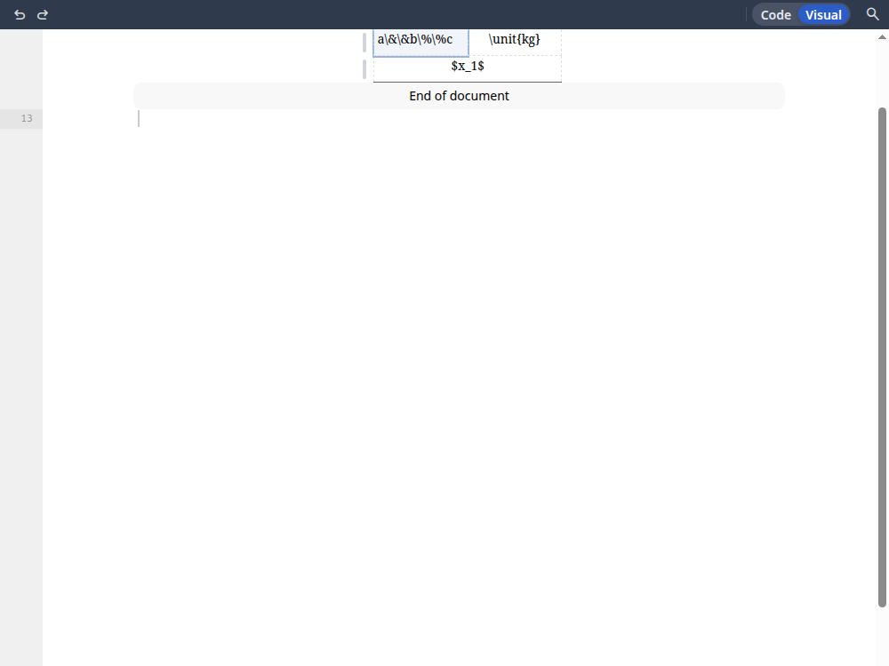
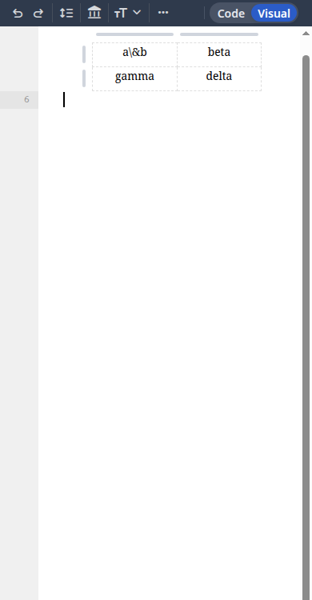

# Table cell input: escaping and caret recovery

Typing or pasting `&` and `%` into the Visual editor's table cells now escapes
each unescaped character once. This applies to an open cell input, a paste onto
selected cells, and the first keystroke that starts editing. Windows CRLF and
bare-CR clipboard rows are handled as rows rather than leaking control characters
into a cell. The caret and replacement selection follow the inserted escapes.

Only three upstream runtime files change: `cell.tsx`, `table.tsx`, and `utils.ts`.
They share one linear filter. It preserves the prior removal of `\\` row
separators entered into a single cell, doing that before escaping adjacent
punctuation. Use the table toolbar to add rows. It leaves single-backslash
commands, labels, underscores and ordinary math such as `$x_1$` unchanged. Plain text underscores still
need explicit LaTeX escaping (`x\_1`); math such as `$x_1$` keeps its meaning.
Existing source outside the edited cells is not normalized.

## Before and after

On staging `1ff3043ca34eaa2c24767fe8c42658acfdc25d09`, six of the first seven
editor regression cases failed. The failures include exact source assertions:

| Input/action | Before | After |
| --- | --- | --- |
| Single pasted event `a&&b%%c` | `a\&&b\%%c` | `a\&\&b\%\%c` |
| Selected-cell paste `a&b` | Adds a column / breaks the grid | Saves `a\&b`, grid remains editable |
| `ab`, caret after `a`, then `&c` | `a\&bc` | `a\&cb`, caret before `b` |
| Replace `bc` in `abcd` with `&&` | `a\&d\&` | `a\&\&d` |

The expanded final suite additionally checks `&` and `%` as the only first
keystroke, so they cannot slip through the table's start-editing path.

[Headless editor component recording](issue44-table-editor.mp4)

## Verification

On 16 November 2026:

- **15 Mocha tests passed:** adjacent and already-escaped punctuation, even/odd
  backslashes and row separators, idempotence, math/macros/underscores, Hindi,
  selection mapping and UTF-16 caret offsets. The suite is on the PR CI list.
- **8 new Cypress editor tests passed**, retries disabled, in headless Chrome.
  They inspect the actual CodeMirror source, including typing/paste paths, middle
  caret and replacement typing, tab-separated CRLF paste, undo/redo, a 390 px
  editor remount, booktabs, multicolumn, math and a custom macro.
- **36 existing Cypress tests passed:** 26 table rendering/toolbar/editing/
  navigation checks and 10 read-only Visual editor checks.
- The exact output of the complex-table test is saved in
  [the compile fixture](fixtures/table-cell-output-44.tex). Its full source is
  byte-identical to the input except `alpha` becomes `a\&\&b\%\%c`.
- That output compiled locally with **Tectonic 0.15.0**, cached resources only.
  Extracted PDF text contains `a&&b%%c`, `kg` and the math cell. CI additionally
  compiles this same fixture with the platform's pinned pdfLaTeX, XeLaTeX and
  LuaLaTeX image.
- Focused UI detector and whitespace checks: clean.

The recording and screenshots show the actual CodeMirror component with the
repository's test providers and mocked compile/MathJax endpoints. A remount with
the saved source tests editor reconstruction, not server persistence or a browser
reload against the Institute deployment. Authenticated running-stack smoke,
server reload and deployed compilation remain acceptance checks. Docker is not
installed locally, and the Institute help route requires login. No production
projects were edited. Keep #44 open until that acceptance is complete.

The earlier review corrections were handled first: reference warning and source
regression in #58, support-address behavior in #57, guide accuracy in #56, and
the 202 CLSI / 50 viewer / 7 toolbar passing checks recorded in #61. Mail delivery,
deployed flags and human review still require their respective acceptance.
